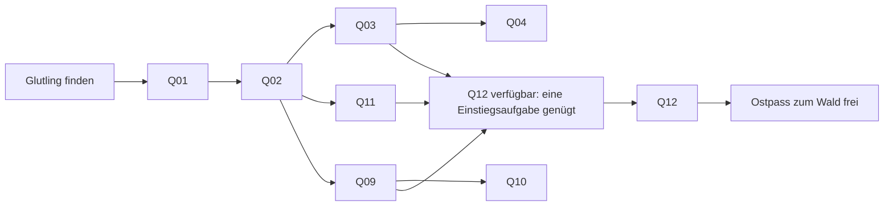
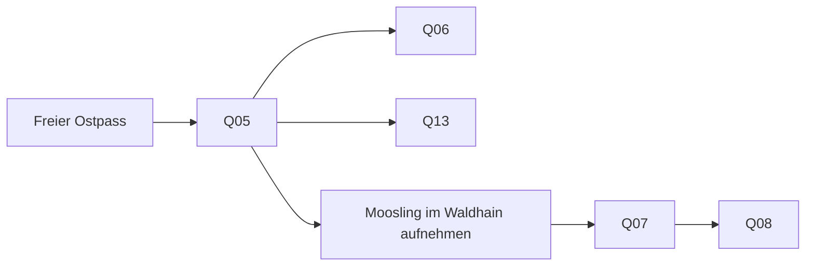

# Gebiets- und Questplan: Tal und Aetherwald

Stand: 14. November 2026. Die aktuelle Nutzerentscheidung ersetzt den bisherigen linearen Durchlauf durch alle acht Quests. Laufzeitdaten stehen in `WorldRegions.ts` und `QuestNetwork.ts`; Aufgabenziele und Lerntexte in `WorldQuests.ts`.

## Tal von Aetheria

Ein von Bergwänden eingefasstes Tal enthält die Akademie, einen westlichen Übungsplatz und Miras Lager am östlichen Pass. Glutling wird am Akademieweg gefunden und ausdrücklich aufgenommen. Bewegung und Angriff bilden das gemeinsame Tutorial. Danach sind drei Einstiegsreihen gleichzeitig verfügbar. Keine dieser Reihen setzt eine andere voraus.

| Questgeber / Ort | Aufgabe | Voraussetzung | Art |
| --- | --- | --- | --- |
| Eldren, Talakademie `(915, 540)` | Q01 Glutlings erste Schritte | Eldren kennenlernen, Glutling sammeln | Bewegung / Sequenz, Rätsel |
| Eldren | Q02 Das Übungskonstrukt | Q01 | Angriffstutorial, passiver Kampf |
| Eldren | Q03 Der lange Runenweg | Q02 | Schleifeneinführung, Rätsel |
| Eldren | Q04 Der Musterpfad | Q03 | Mehrere Anweisungen gemeinsam wiederholen, Folge-Rätsel |
| Brann, Westplatz `(440, 390)` | Q11 Branns Übungswache | Q02 | Eigene Schleifeneinführung, Kampf |
| Mira, Ostpasslager `(1280, 650)` | Q09 Miras Runentreppe | Q02 | Eigene Einführung in Schleifen und verschachtelte Schleifen, Rätsel |
| Mira | Q10 Miras Schlagmuster | Q09 | Verschachtelte Schleifen, Folge-Kampf |
| Mira / Runenwinde vor dem Pass | Q12 Die Runenwinde am Steinrutsch | Q02 und **eine** aus Q03, Q09 oder Q11 | Verschachteltes Bewegungsrätsel, Gebietsfreigabe |

Die Pfeile zum gemeinsamen Q12-Knoten bedeuten Alternativen. Es müssen nicht alle Aufgaben abgeschlossen werden. Q12 erklärt die Verschachtelung auch dann selbst, wenn die gewählte Einstiegsreihe nur einfache Schleifen verwendet hat. Eine neue Programmstruktur wird somit nicht vorausgesetzt, bevor sie erläutert wurde.

### Steinrutsch und Reise

Die östliche Bergwand besitzt genau einen Durchlass. Vor der Freigabe versperren Felsen und ein physischer Kollisionskörper die gesamte Lücke; um die Felsen herum führt kein Weg in den Wald. Vor dem Rutsch steht die Runenwinde, der eigentliche Reiseort liegt dahinter. Ein Fehlversuch, ein bloßer Questbesuch oder eine abgebrochene Wiedergabe entfernt die Blockade nicht. Erst der bestätigte Q12-Abschluss deaktiviert die Kollision und blendet die Felsen aus.

Danach ist der Wald über den Pass erreichbar. Nach der Gebietsfreigabe bietet auch das Questjournal einen ausdrücklichen Reisebutton an. Rückreisen ins Tal und offene Talaufgaben bleiben möglich. Die Reise speichert das Gebiet und startet die Weltansicht mit den zugehörigen NPCs, Hindernissen und Fundbegegnungen neu; Programme werden dabei nicht verändert.

## Aetherwald

Der Wald besitzt eine andere Bodengestaltung, mehr Baumgruppen, Waldpfade und eigene Questgeber. Lyra wartet nahe dem Eingang. Ihre Einführung ist die gemeinsame Voraussetzung für die Wald-Wahlaufgaben; diese müssen anschließend nicht in einer bestimmten Reihenfolge gelöst werden.

| Questgeber / Ort | Aufgabe | Voraussetzung | Art |
| --- | --- | --- | --- |
| Lyra, Waldpfad `(600, 490)` | Q05 Der aufmerksame Begleiter | Waldzugang, Q02 | Pflicht-Einführung in Bedingung und Verzweigung, zwei kurze Startsituationen |
| Lyra | Q06 Der bewegliche Wächter | Q05 | Frei wählbarer aktiver Kampf mit wiederholter Entscheidung |
| Neria, Runenlichtung `(1140, 390)` | Q13 Nerias Lichtpfad | Q05 | Frei wählbares Rätsel mit der Abfrage „Weg rechts frei?“ |
| Tala, Hainlager `(1030, 800)` | Q07 Mooslings eigener Weg | Q05 und aufgenommenes Moosling | Frei wählbare Objekt-/Arteneinführung, passiver Kampf |
| Tala | Q08 Zwei Programme, ein Ziel | Q07, beide Arkana gesammelt | Team-Einführung und Folge-Kampf |

Moosling erscheint nach Q05 im südöstlichen Waldhain `(1450, 915)`. Es wird nicht automatisch vergeben und verschwindet nach der Aufnahme samt Interaktion. Q06 ist keine Voraussetzung für Moosling oder Nerias Rätsel. Der zweite reguläre Teamplatz wird erst bei Annahme der Q08-Einführung geöffnet.

## Bedienung und Fortschritt

- NPCs öffnen ein Menü mit ihren Aufgaben und Folgequests. Voraussetzungen und verfügbare Aufgaben werden ausdrücklich benannt.
- Das Journal gruppiert Tal und Wald und nennt Questgeber, Aufgabenart, Status und fehlende Voraussetzungen. Nicht zugängliche Aufgaben sind gesperrt; ein Journal-Klick umgeht keine Gebietsgrenze.
- Ziele werden in jedem Aufgabenraum zunächst angezeigt und bleiben wieder aufklappbar. Tipps sind getrennt ausklappbar. Block- und Textmodus verwenden dieselben Freigaben und Nachweise.
- Verschachtelte Schleifen müssen innen in mindestens zwei äußeren Durchläufen jeweils mindestens zweimal wirksam laufen. Leere Schleifen und reine Textpräsenz genügen nicht.
- Der Lichtpfad prüft Steine, Kartenränder und belegte Nachbarfelder tatsächlich. Dieselbe Verzweigung muss beide Antworten mit passenden Bewegungen zeigen.
- Bestehende Abschlüsse und Entwürfe bleiben unter ihren IDs erhalten. Frühere Spielstände mit bereits abgeschlossener Bedingungseinführung behalten den Waldzugang über eine ausdrücklich gekennzeichnete Übergangsfreigabe. Neue Talquests werden dadurch **nicht** als bestanden markiert.
- Neue Spielstände beginnen im gesperrten Tal. Für einen vollständigen neuen Einstieg gibt es weiterhin **Charakter → Sammlung → Neues Abenteuer**, einschließlich Sicherung des bisherigen Stands.
